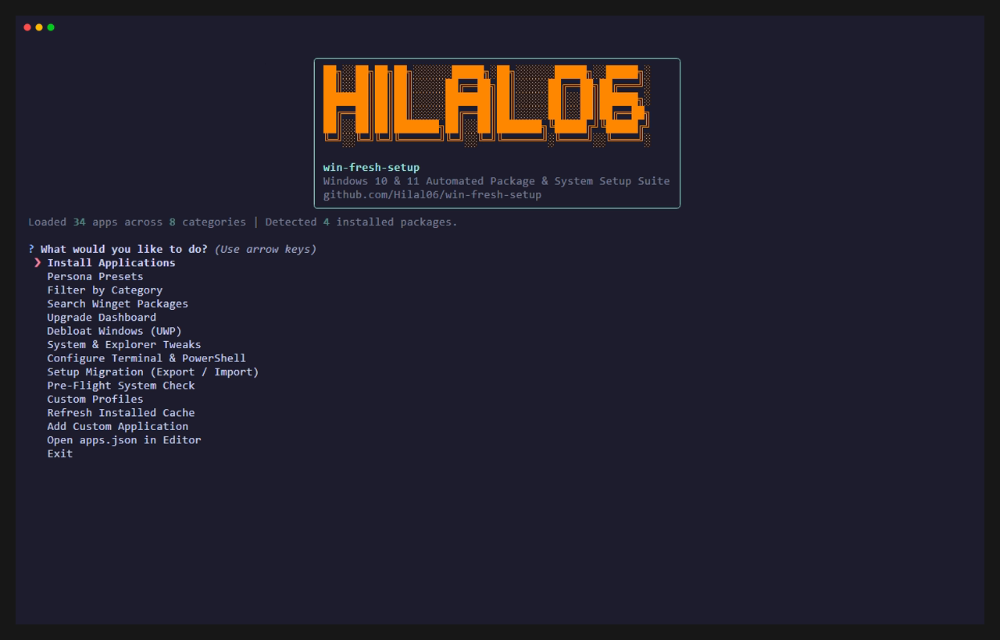
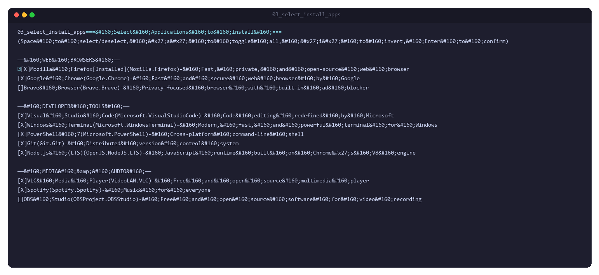
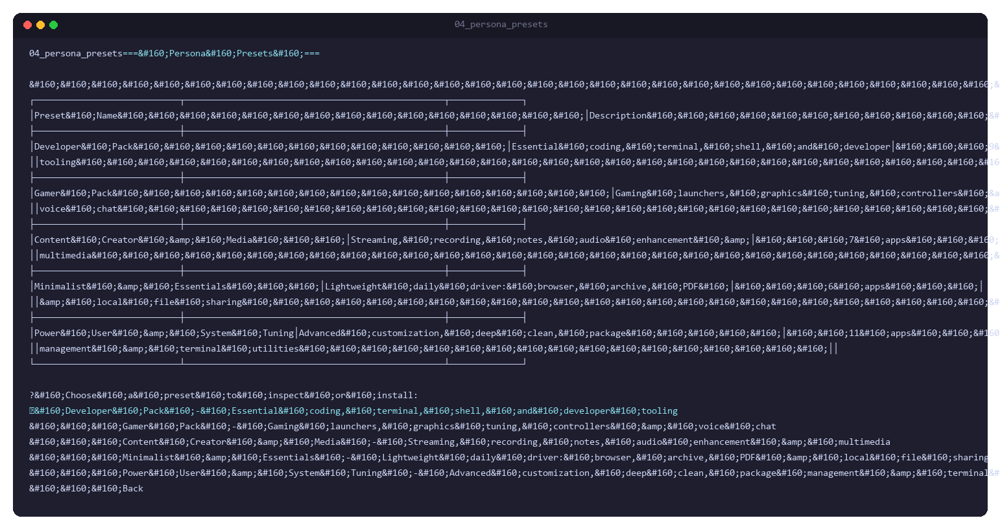
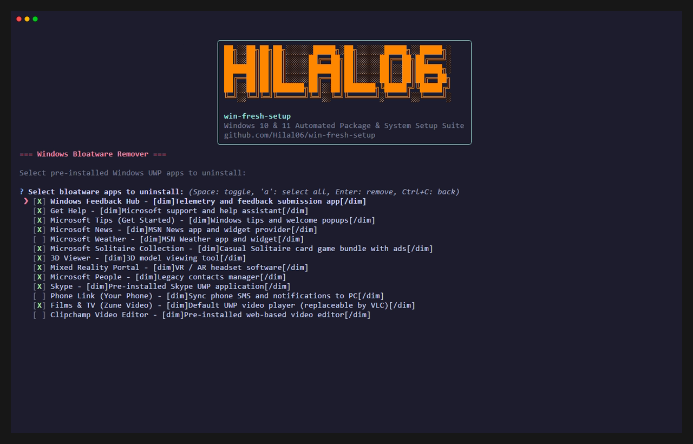
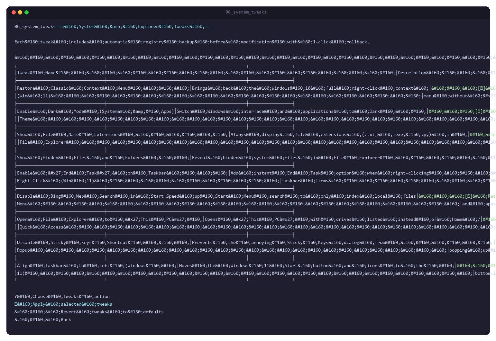
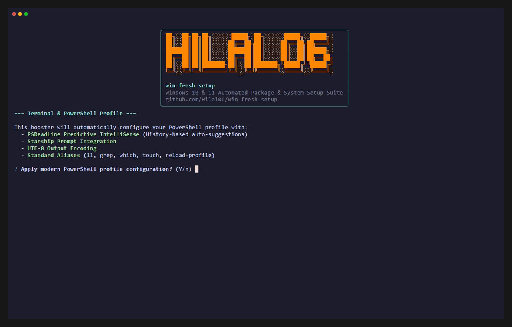
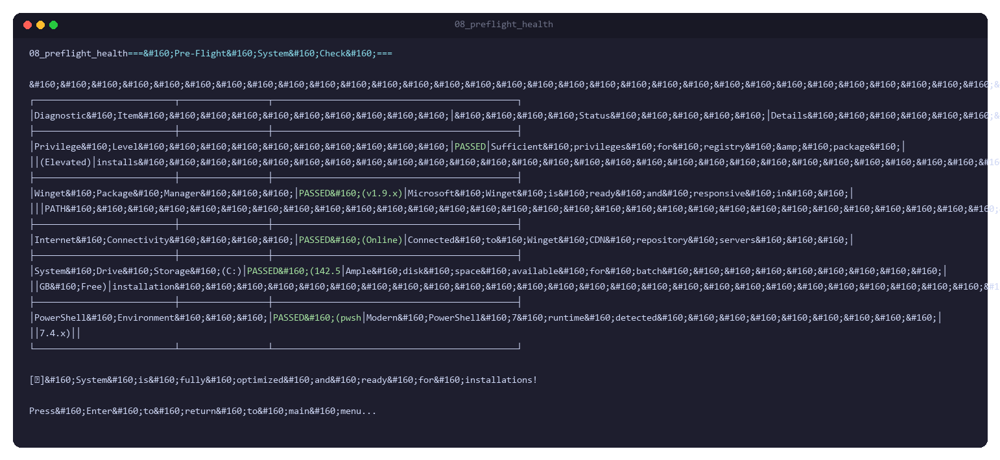
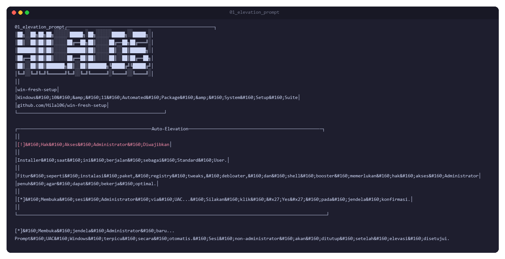

# win-fresh-setup

[](https://github.com/Hilal06/win-fresh-setup/actions/workflows/ci.yml)
[](LICENSE)
[](https://www.microsoft.com/windows)
[](https://github.com/microsoft/winget-cli)

An interactive Terminal User Interface (TUI) and automated provisioning suite for Windows 11 and 10. Built with Python, `rich`, `questionary`, and Microsoft Winget, `win-fresh-setup` allows users and developers to batch-install curated software packages, remove pre-installed Windows UWP bloatware, apply reversible system registry tweaks, configure modern shell environments, and migrate setup profiles across machines.

<p align="center">
  
</p>

---

## Quick 1-Line Online Bootstrap (No Git Required)

To provision a fresh Windows installation without cloning the repository or installing Git manually, open PowerShell as **Administrator** and run:

```powershell
Set-ExecutionPolicy Bypass -Scope Process -Force; irm https://raw.githubusercontent.com/Hilal06/win-fresh-setup/main/bootstrap.ps1 | iex
```

### What the Bootstrap Script Does:
1. **Privilege Escalation**: Verifies Administrator rights; automatically prompts a native UAC dialog (`runas`) if launched in a non-elevated shell.
2. **Repository Fetching**: Downloads and extracts the latest repository archive to `%TEMP%\win-fresh-setup`.
3. **Environment Setup**: Detects a functional Python 3.10+ binary (bypassing zero-byte Windows Store shims), creates an isolated virtual environment (`.venv`), and installs runtime dependencies (`rich`, `questionary`).
4. **Execution & Cleanup**: Runs the interactive TUI installer and removes all temporary setup files upon exit.

---

## Key Features

* **Interactive Multi-Select Checkbox TUI**: Keyboard-driven application selector with category grouping, status badges, and selection modifiers (`Space` to toggle, `a` for select-all, `i` for invert).
* **Curated Persona Presets**: One-click bundles for Developers, Gamers, Content Creators, Minimalists, and Power Users.
* **Batch Windows Debloater**: Uninstalls telemetry and default UWP bloatware packages in a single PowerShell session using `pwsh` / `powershell`.
* **System & Explorer Tweaks with Rollback**: Reversible registry optimizations (Classic Windows 10 context menu, Dark Mode, show file extensions, taskbar End Task, disable Bing search) with automated timestamped JSON backups and one-click rollback.
* **Terminal & PowerShell Booster**: Configures the active PowerShell profile with **PSReadLine Predictive IntelliSense**, **Starship prompt** integration, UTF-8 console output, and standard utility aliases (`ll`, `grep`, `which`, `touch`).
* **Live In-App Winget Search**: Query the online Microsoft Winget catalog directly within the TUI to install or permanently bookmark new software into `apps.json`.
* **Interactive Upgrade Dashboard**: Dual-mode outdated software inspection (`Quick Scan` for versioned packages, `Deep Scan` for unversioned binaries) with selective or batch upgrade options.
* **PC Setup Migration (Backup & Restore)**: Export installed Winget software inventory to a portable JSON manifest and import it onto another machine.
* **Pre-Flight System Diagnosis**: Real-time validation of drive `C:\` storage space, administrator elevation status, network connectivity, and Microsoft Winget CDN availability.
* **High-Performance Caching**: Persistent disk caching (2-hour TTL) for installed package resolution and incremental cache updates post-installation, eliminating repetitive 10-15s `winget list` delays.

---

## Feature Showcase

| View / Feature | Preview | Technical Description |
|---|:---:|---|
| **Main Navigation Menu** | <a href="demo/02_main_menu.png"></a> | Central dashboard displaying active privilege status, package cache counters, and quick access to all provisioning subsystems. |
| **Batch Application Selector** | <a href="demo/03_select_install_apps.png"></a> | Multi-select checkbox interface with custom indicators (`[X]`/`[ ]`), real-time `[Installed]` badges, category separators, and instant select-all modifiers. |
| **Persona Presets** | <a href="demo/04_persona_presets.png"></a> | Pre-configured application profiles tailored for Developer, Gamer, Creator, Minimalist, and Power User workstation setups. |
| **Windows Debloater** | <a href="demo/05_debloater.png"></a> | Single-session batch uninstallation of pre-loaded Windows UWP packages (Feedback Hub, 3D Viewer, Solitaire, Bing News, Tips). |
| **System & Explorer Tweaks** | <a href="demo/06_system_tweaks.png"></a> | Direct Windows registry tweaks with native `winreg` C-API recursive deletion and automated JSON snapshot backups for safe rollback. |
| **PowerShell & Terminal Booster** | <a href="demo/07_shell_booster.png"></a> | Injects modern profile configurations including PSReadLine predictive history autocomplete, Starship prompt initialization, and power-user aliases. |
| **Pre-Flight System Check** | <a href="demo/08_preflight_health.png"></a> | Diagnostic probe verifying drive `C:\` available capacity, UAC elevation status, DNS/Internet reachability, and Winget CDN responsiveness. |
| **UAC Elevation Prompt** | <a href="demo/01_elevation_prompt.png"></a> | Early privilege inspection verifying process tokens and triggering native Windows `runas` elevation when started by standard users. |

---

## Default Apps Included

The repository ships with **34 pre-configured applications** across 8 functional categories.

| Category | Apps Count | Highlights Included |
|---|:---:|---|
| **Web Browsers** | 3 | Mozilla Firefox, Google Chrome, Brave Browser |
| **Media & Audio** | 4 | VLC Media Player, FxSound, Spotify, OBS Studio |
| **Productivity & Documents** | 4 | PDFgear, Notepad++, 7-Zip, Obsidian |
| **Communication & Social** | 3 | Discord, WhatsApp, Telegram Desktop |
| **File Sharing & Remote Access** | 4 | Quick Share (Google), LocalSend, RustDesk, Tailscale |
| **Developer Tools** | 7 | VS Code, Windows Terminal, PowerShell 7, Starship, Node.js (LTS), Git, Arduino IDE |
| **Gaming & Peripherals** | 3 | Steam, NVIDIA App, DS4Windows |
| **System & Customization** | 6 | UniGetUI, Bulk Crap Uninstaller, Winaero Tweaker, Windhawk, Wise Disk Cleaner, PowerToys |

> **Detailed Package Manifest:**
> See the complete list of package IDs, descriptions, and default states in **[APPS.md](APPS.md)**.

---

## How to Run Locally

### Prerequisites
* Windows 10 (version 1809 or higher) or Windows 11
* Windows App Installer / Winget CLI (`winget --version`)
* Elevated Administrator privileges (recommended)

---

### Method 1: Using `run.bat` (Recommended for CMD)

Double-click `run.bat` or execute it from an elevated Command Prompt:

```cmd
run.bat
```

1. Checks for Administrator privileges and requests UAC elevation if needed.
2. Checks for modern PowerShell (`pwsh.exe`); installs `Microsoft.PowerShell` via Winget if missing and transitions execution to PowerShell 7.
3. Automatically configures `.venv`, installs requirements, and launches `installer.py`.

---

### Method 2: Using `run.ps1` (Recommended for PowerShell)

Launch via PowerShell or Windows Terminal:

```powershell
powershell -ExecutionPolicy Bypass -File .\run.ps1
```

If you are using PowerShell 7 (`pwsh`):

```powershell
pwsh -ExecutionPolicy Bypass -File .\run.ps1
```

The script fast-paths execution directly to `.venv\Scripts\python.exe` when dependencies are already satisfied, launching the TUI in under 200 ms.

---

### Method 3: Manual Python Execution

If you prefer managing the environment manually:

```powershell
# 1. Create virtual environment
python -m venv .venv

# 2. Install dependencies
.\.venv\Scripts\pip install -r requirements.txt

# 3. Launch TUI installer
.\.venv\Scripts\python installer.py
```

---

## Testing

The project includes an automated offline test suite covering schema validation, registry operations, debloater execution logic, and caching systems.

Run the test suite locally using the virtual environment interpreter:

```powershell
.\.venv\Scripts\python.exe test_installer.py
```

### Verified Test Suites (13/13):
1. **Module Imports**: Verifies `questionary`, `rich`, `installer`, `tweaks`, `debloat`, and `shell_booster`.
2. **`apps.json` Schema Integrity**: Ensures all entries contain non-empty `category`, `name`, `id`, `description`, and boolean `default`.
3. **`presets.json` Validation**: Validates that every ID referenced in presets exists in `apps.json`.
4. **Registry Tweaks Module**: Validates registry key actions and automated JSON backup file generation.
5. **Debloat Definition Validation**: Validates all UWP target identifiers.
6. **Shell Booster Configuration**: Validates generated profile paths and PSReadLine / Starship blocks.
7. **Winget Table Parser**: Tests fixed-width column parsing against simulated tabular outputs.
8. **ASCII Art Title Loader**: Validates banner reading and fallback formatting.
9. **Questionary Choices Generator**: Tests category grouping, indicator formatting (`[X]`/`[ ]`), and token structures.
10. **Winget CLI Accessibility**: Checks runtime availability of `winget.exe`.
11. **Logging Directory Creation**: Ensures `logs/` directory creation logic functions reliably.
12. **Installed Apps Disk Caching & Incremental Updates**: Tests cache persistence (`.installed_cache.json`), 2-hour TTL expiration, incremental additions, and memory-cached `load_apps()`.
13. **Batch Debloater & Native Winreg Deletion**: Tests `pwsh`/`powershell` executable resolution, batch removal interface, and pure Win32 `winreg` recursive tree deletion.

---

## Changelog (Dev Summary)

Refer to **[CHANGELOG.md](CHANGELOG.md)** for detailed version history.

```text
[v1.2.0-dev] - 2026-10-22
  + Performance: Implemented persistent disk caching (logs/.installed_cache.json) with 2-hour TTL.
  + Performance: Added incremental cache mutation post-installation (removes 10-15s winget list freeze).
  + Performance: Refactored Windows Debloater to single-session batch execution via pwsh / powershell.
  + Performance: Converted registry tree deletion in tweaks.py to pure Win32 winreg C-API recursion.
  + Performance: Added launcher short-circuit fast-path in run.ps1 & run.bat targeting .venv directly.
  + Performance: Added Dual-Mode scanning (Quick Scan vs Deep Scan) in Interactive Upgrade Dashboard.
  + Performance: Added mtime-based in-memory caching for apps.json parsing.
  + Testing: Expanded automated test suite from 11 to 13 test suites.

[v1.1.0] - 2026-09-26
  + Feature: Automated VHS demo script and terminal showcase GIF preview.
  + Feature: Added visual 2-column feature screenshot gallery in documentation.
  + Automation: CMD-to-PowerShell 7 auto-upgrade and session transition in run.bat.
  + Security: Pre-menu Administrator elevation prompt via Windows ShellExecuteW (runas).
  + Core: Direct .venv binary invocation bypassing execution policy restrictions.
  + Fix: Resolved Microsoft Store 0-byte python.exe execution alias trap.

[v1.0.0] - 2026-09-06
  + Initial release: Interactive Checkbox TUI, Persona Presets, System Tweaks,
    UWP Debloater, Shell Booster, PC Migration, Pre-Flight Health Check.
```

---

## Author & Credits

* **Author:** [Hilal06](https://github.com/Hilal06)
* **Repository:** [https://github.com/Hilal06/win-fresh-setup](https://github.com/Hilal06/win-fresh-setup)
* **License:** [MIT License](LICENSE)

### References & Core Tool Credits
* **[Chris Titus Tech (WinUtil)](https://github.com/ChrisTitusTech/winutil)**: Inspiration for Windows system tweaks, elevation flow, and automated debloating concepts.
* **[Microsoft Winget](https://github.com/microsoft/winget-cli)**: Official Windows Package Manager client engine.
* **[Questionary](https://github.com/tmbo/questionary)**: Python interactive prompt and multi-select CLI controls (built on `prompt_toolkit`).
* **[Rich](https://github.com/Textualize/rich)**: Terminal formatting, styling, progress indicators, and tabular rendering by Will McGugan.
* **[Starship](https://starship.rs)**: Minimalist, cross-shell prompt integration.
* **[PSReadLine](https://github.com/PowerShell/PSReadLine)**: Command-line editing and predictive IntelliSense for PowerShell.
* **[Charm VHS](https://github.com/charmbracelet/vhs)**: Terminal recording automation for documentation demos.
